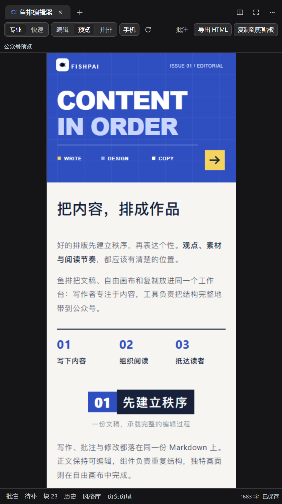
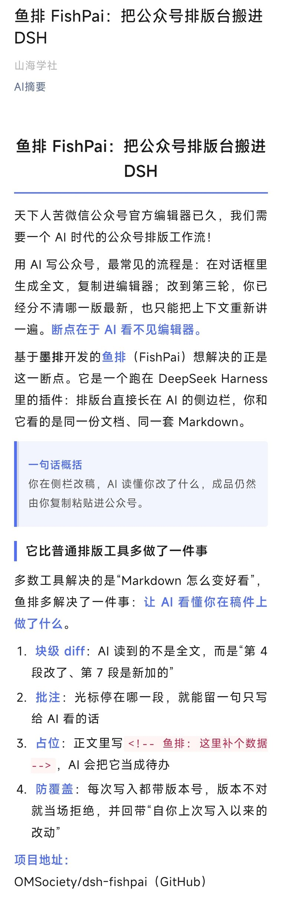

<div align="center">
<h1><br>鱼排编辑器 FishPai</h1>

  <p>公众号排版工作台，长在 DeepSeek Harness 的右侧栏里。</p>
  <p>人在侧栏改字、加批注与占位；模型用<strong>块级 diff</strong> 看懂你改了什么、想要什么；成品可复制粘贴进公众号编辑器，也可一键存为微信 / 秀米草稿。</p>

  <p>
    <a href="https://www.npmjs.com/package/dsh-fishpai"></a>
    <a href="https://github.com/deepseek-ai/dsh"></a>
    <a href="LICENSE"></a>
    <a href="https://github.com/OMSociety/dsh-fishpai/stargazers"></a>
    <a href="https://github.com/OMSociety/dsh-fishpai/issues"></a>
  </p>

<a href="#这是什么">这是什么</a> • <a href="#核心特性">核心特性</a> • <a href="#效果">效果</a> • <a href="#安装方式">安装方式</a> • <a href="#模型工具">模型工具</a> • <a href="#面板快捷键">面板快捷键</a> • <a href="#开发">开发</a> • <a href="#许可证与作者">许可证与作者</a>
</div>

## 这是什么

**鱼排编辑器**把 Markdown 排成**内联样式 HTML**：整段粘进微信公众号编辑器就得到成品排版。

它同时是一个**人在回路里的改稿台**——面板与模型看的是同一篇文档，谁改了什么一目了然。

快速模式使用本仓库维护的渲染内核与主题，初始设计源自 [MoPai 墨排 / mopai-markdown](https://github.com/ye4wzp/mopai-markdown)（MIT）；专业模式提供文档级画布规格、语义组件与自由 HTML / SVG 创作区。署名与许可链条见 [`NOTICE.md`](NOTICE.md)。

## 核心特性

| 特性 | 说明 |
|---|---|
| **Markdown 快捷键** | 选中后 `Ctrl/⌘+B` 加粗、`+I` 斜体、`+K` 链接、`+Alt+1/2/3` 标题、`+Shift+8/7` 列表；列表里回车自动续写 |
| **图片直接粘进来** | 截图 `Ctrl/⌘+V` 粘入（也可以拖进来）→ 存到文档同级的 `assets/`，正文自动插入引用，预览立刻可见 |
| **实时预览 + 手机宽度** | 打字 300ms 后预览跟着变；栏位够宽左右并排，窄了自动单栏；可切 375px 看公众号真实观感 |
| **批注与占位** | 光标所在段落加批注（模型下次 `fishpai_read` 就能看到）；正文里写 `<!-- 鱼排: 这里补个过渡 -->` 也一样；点批注「定位」直接选中它引用的那段 |
| **块级 diff 与局部改稿** | 模型只改该改的块，你的其它改动原样保留；写入必须带 `base_revision`，不符**先拒**并回带"自你上次写入以来的改动" |
| **冲突不丢字** | 模型与你同时改时给出「用我的覆盖 / 看 AI 的版本」，采用 AI 版会先把你的草稿存进历史 |
| **主题与主题色** | 11 套主题，按"是否适合公众号"分组；主题色只对「默认公众号」生效（用不上的取色行会自动隐藏），有风险的主题直接提示原因；另有用户级「命名主题库」（模型可在内置主题上只改几个槽位，存为多套命名主题） |
| **复制与导出** | 复制为 `text/html` + `text/plain` 双格式；本地图片内嵌 base64，粘过去**不用手动重传**；也能导出成自包含 `.html` |
| **写作风格学习** | 从定稿 / HTML / 公开网页反推九字段写作风格，经暂存预览与你确认后入库；附写作规范参考（风格卡、AI 味指纹、五维自评、文末收束） |
| **页头页尾片段库** | 页头首图、可配置页尾锚点片段经预览确认后入库，渲染时按 `snippetId` 装配 |
| **微信约束检查** | `fishpai_lint` 检查全内联、禁用标签 / 属性、position、CSS 变量、grid、文本包裹、正文对比度、全幅限宽与表格默认边框 |
| **专业自由画布** | 18 项文档级 `xiumi_spec` 控制画布、字阶与组件配色；`full_bleed` 处理整幅出血，章节头、信息卡、重点行、制作名单与 8 个交互组件可同自由 HTML / SVG 混排，本地素材在预览、复制与导出间同源使用 |
| **八个模型工具** | `fishpai_open` / `read` / `write` / `render` / `theme` / `learn` / `snippets` / `lint`，配一份教模型怎么用的技能 |

## 效果

<table>
<tr>
<td width="64%" align="center"></td>
<td width="36%" align="center"><a href="https://raw.githubusercontent.com/OMSociety/dsh-fishpai/main/docs/wechat-fishpai.jpg"></a></td>
</tr>
<tr>
<td align="center">正式面板：专业模式默认展示公众号预览，文稿编辑、组件插入与文档辅助栏可按需展开</td>
<td align="center">发布到公众号后的实机截图</td>
</tr>
</table>

同一份 HTML 用「导出 HTML」存成文件、在浏览器里打开，看到的就是面板中的公众号页面。仓库内的 [正式面板预览](docs/preview/panel.html) 可离线打开，并支持 `#theme=light` / `#theme=dark` 切换主题。

## 安装方式

**从 npm 安装**

```powershell
# 先停掉正在运行的 DSH（运行中的服务会锁住依赖，装完再起）
dsh plugin --profile <profile> add "dsh-fishpai"
```

> 装好后**刷新一下浏览器页面**，「鱼排编辑器」从右侧栏的引导页打开——只重启宿主不够，客户端产物是页面加载时取的；入口与布局按会话记忆，新会话第一次要点一次（模型调 `fishpai_open` 时也会自动打开）。
> 命名主题、写作风格与页头页尾片段存于用户级 `storageDomain`，跨工作目录、跨重启保留。插件运行不需要浏览器或平台登录。

**装完怎么用**

1. 让模型 `fishpai_open` 打开一篇 Markdown → 右侧栏应**自动弹出**鱼排并显示正文与预览
2. 在面板里打字 → 预览跟着变；选中文字按 `Ctrl/⌘+B` → 变成 `**加粗**`，`Ctrl+Z` 能撤销
3. 截图后 `Ctrl/⌘+V` → 正文出现 ``，预览里能看到图，文档同级多出 `assets/` 目录
4. 光标放在某段上点「＋批注」写一句要求，再到正文里写一行 `<!-- 鱼排: 这里补个过渡 -->`
5. 让模型 `fishpai_read` → 它应当说出**你改了哪一块、批注要求什么、占位在哪一行**
6. 让模型 `fishpai_write`（`mode: "patch"`）→ 只有那块变了，你其它改动原样保留
7. 点「复制到剪贴板」→ 粘进公众号编辑器，版式正确（标题 / 列表 / 引用 / 表格 / 信息卡片）
8. 微信编辑器弹出「内容结构检测」时，点**「继续插入」**即可——它对 SVG 包裹层的 `line-height:0` 报「行高异常」，这是 SVG 排版的正常写法，不影响正文阅读

> **提示**：微信的 HTML 清洗比浏览器严格。实测会把 `:::raw` 里的 `<div>` 转成不带内联样式的 `<p>`（字号、颜色等随样式一起丢失），也会剥离 SVG `<image>` 的 `href`。因此 raw 区块请使用 `<section>` / `<p>` / `<span>` / `<table>` / `<svg>` 并写内联样式，SVG 图形用 `path` / `rect` 等形状直绘。需要顶到页面左右边缘的内容用 `:::full_bleed`，不要手写固定负外边距；表格单元格先写 `border:0`，再保留指定边线。含手写 raw 的复制或导出候选，可用 `fishpai_lint` 检查发布形态。`expand` / `swap` 的折叠态可以正常显示；点击展开依赖 SMIL 动画，请在目标账号上实测后再依赖。需要严格一致的场景，把补充内容写成普通段落或 `:::raw` 静态结构。

## 模型工具

| 工具 | 作用 | 关键参数 |
|---|---|---|
| `fishpai_open` | 打开 / 新建文档，并在右侧栏弹出面板 | `path`（可省扩展名，自动补 `.md`）、`markdown`（新建时写正文）、`theme`、`xiumi_spec`（专业画布持久规格） |
| `fishpai_read` | **改稿前必做**：读块级 diff、批注、占位、图片提醒与块 id | `doc_key`、`include` |
| `fishpai_write` | 改稿。必须带 `base_revision`；优先按块改 | `doc_key`、`base_revision`、`mode`（`patch` / `replace`）、`patches[{block_id 或 block_index, op, markdown}]` |
| `fishpai_render` | 导出可粘贴 / 归档的自包含 HTML（本地图片内嵌 base64） | `out_path`（可省扩展名）、`theme`、`theme_spec`（临时自定义主题，不落盘）、`target`（`'xiumi'` 专业默认 / `'wechat'` 快速）、`xiumi_spec`（当次画布覆盖）、`snippetId`（装配页头页尾片段）、`publish`（`false` = 预览原样形态）、`embed_images` |
| `fishpai_theme` | 用户级**「命名主题库」**（多套，`set` / `show` / `clear` / `list`）：模型在某套内置主题上只覆盖想改的槽位，存为 `custom:<id>` 命名主题 | `action`、`theme_id`、`theme_spec` |
| `fishpai_learn` | 写作风格学习：反推九字段风格，暂存预览后确认入库 | `action`（`preview` / `commit` / `list` / `delete`）、`markdown` / `html` / `url` / `path`、`pending_id`、`confirm` |
| `fishpai_snippets` | 页头页尾片段库：预览确认后入库，渲染时按名装配 | `action`、`name`、`headerHtml` / `footerHtml` / `footerImg`、`footerAnchors`、`pending_id`、`confirm` |
| `fishpai_lint` | 微信约束检查：全内联、禁用标签 / 属性、position、CSS 变量、grid、文本包裹、正文对比度、全幅限宽与表格默认边框 | `html` |

模型的标准动作顺序是 **`open` → 等你改 → `read` → `write` → 你点复制**；技能 `fishpai`
（随插件注册）里写明了这套纪律与排版口径，模型会在需要时自己读。

## 面板快捷键

| 快捷键 | 作用 | 快捷键 | 作用 |
|---|---|---|---|
| `Ctrl/⌘ + B` | 加粗 | `Ctrl/⌘ + Alt + 1/2/3` | 一级 / 二级 / 三级标题 |
| `Ctrl/⌘ + I` | 斜体 | `Ctrl/⌘ + Alt + 0` | 正文（去掉标题） |
| `Ctrl/⌘ + E` | 行内代码 | `Ctrl/⌘ + Shift + .` | 引用 |
| `Ctrl/⌘ + K` | 链接 | `Ctrl/⌘ + Shift + 8` / `+ 7` | 无序 / 有序列表 |
| `Ctrl/⌘ + Shift + X` | 删除线 | `Tab` / `Shift + Tab` | 缩进 / 反缩进 |
| `Ctrl/⌘ + S` | 保存 | `Ctrl/⌘ + Shift + C` | 复制到剪贴板 |
| `Ctrl/⌘ + V` | 粘贴图片（或拖进来） | `Ctrl/⌘ + Enter` | 添加批注（在批注框里） |

编辑器右上角的「快捷键」按钮里就是这份表（Mac 显示 `⌘`、Windows 显示 `Ctrl`）。

## 数据放在哪

| 位置 | 内容 | 说明 |
|---|---|---|
| 你指定的 `.md` | 文档正文 | 普通 Markdown，任何编辑器都能改；鱼排不往正文里塞标记 |
| `.fishpai/docs/` | 没指定路径时新建的文档 | `fishpai_open` 省略 `path` 就落在这里，按标题命名 |
| `<文档同级>/assets/` | 粘贴进来的图片 | 相对路径引用（`assets/xxx.png`），文档搬走图也跟着走 |
| `.fishpai/state/` | 主题、revision、baseline、批注 | 按文档路径哈希命名；删掉会丢批注、历史与「模型上次写入的基线」（正文不动，但模型暂时看不出你改了什么） |
| `.fishpai/history/` | 历史快照（最多 50 份） | 面板「历史」抽屉里可一键回滚 |
| 用户级存储（`storageDomain`） | 命名主题库、写作风格库、页头页尾片段库 | 跨工作目录、跨重启持久；命名主题为 `custom:<id>` |
| `.fishpai/.gitignore` | 忽略 `state/`、`history/` | 插件自建，只追加缺失的行（你写的改动一字不动）；正文与图片是否入库由你自己决定 |

## 开发

```powershell
npm install        # 安装运行与开发依赖
npm test           # 全量回归：golden + 站点对照 + 块/diff/批注/补丁 + 宿主红线 + 微信兼容层 + 主题规格 + 主题图标内联核对 + bundle + 快捷键 + 挂载 + 客户端 store 时序 + 接口层（api）
npm run typecheck  # 客户端 TSX 类型检查
npm run build      # 重新打包 lib/client.js（改完客户端必须跑，并提交产物）
npm run build:preview  # 用正式面板与 fixture 重建 README 预览，并在 Chrome 验收展开交互
npm run check:build  # 确认 lib/ 无漂移
```

目录与「改东西去哪」：

```
plugin/index.mjs        宿主入口：注册工具 + /fishpai/api 路由 + fishpai 技能
plugin/core/            渲染内核（ESM，零依赖）：runtime / markdown / render / diff / notes / patch / theme-info / theme-spec / learn / snippets / wechat-lint / xiumi/
plugin/host/            宿主侧：工具契约、HTTP 路由、文档存储、图片、命名主题与 storageDomain 封装
plugin/vendor/          内置主题 themes.js + markdown-it 14.1.0 + highlight.js 11.9.0 + hljs-map.json
client/                 客户端源码（TSX → esbuild 打成 lib/client.js）
lib/client.js           客户端 bundle（入库；dsh plugin add 不做构建）
scripts/preview/        正式 README 面板预览入口与确定性 fixture
docs/preview/           自包含面板 HTML 与接口数据
skills/fishpai/         鱼排技能：教模型怎么选主题、怎么按块改稿
test/                   golden、站点对照、块/diff/批注/补丁、宿主红线、微信兼容层、主题规格、主题图标内联核对、bundle 形态、快捷键、真实 Cordis 挂载、客户端 store 时序、接口层（api）
```

用微信官方校验器复验（需要本机 Chrome，不进依赖）：

```powershell
git clone --depth 1 https://github.com/wechatjs/verify-article-structure-spec "$env:TEMP\was"
cd "$env:TEMP\was\cli"; $env:PUPPETEER_SKIP_DOWNLOAD='true'; npm install
$env:PUPPETEER_EXECUTABLE_PATH='C:\Program Files\Google\Chrome\Application\chrome.exe'
npx tsx src/index.ts <导出的 article.html> --json    # isValid: true 即通过
```

## 支持与致谢

- 如果这个插件对你有帮助，欢迎点亮 Star，有问题和建议请提交 [Issue](https://github.com/OMSociety/dsh-fishpai/issues) 或 [Pull Request](https://github.com/OMSociety/dsh-fishpai/pulls)；动手前请读 [`CONTRIBUTING.md`](CONTRIBUTING.md)，安全相关问题走 [`SECURITY.md`](SECURITY.md) 的私密渠道。
- 想改主题或加一套自己的：主题定义集中在 `plugin/vendor/themes.js`，加完跑 `npm run test:golden:regen` 重生成 golden

- [MoPai 墨排 / mopai-markdown](https://github.com/ye4wzp/mopai-markdown)（MIT）：快速渲染管线、主题与复制行为的衍生来源
- [markdown-it](https://github.com/markdown-it/markdown-it)（MIT）与 [highlight.js](https://github.com/highlightjs/highlight.js)（BSD-3-Clause）：随包内嵌的 vendor 资产
- [DeepSeek Harness](https://github.com/deepseek-ai/dsh)：插件、右侧栏与技能的宿主

## 许可证与作者

[MIT](LICENSE)。来源项目 `mopai-markdown` © 2026 [@ye4wzp](https://github.com/ye4wzp)；本仓库新增部分 © 2026 [@OMSociety](https://github.com/OMSociety)。
