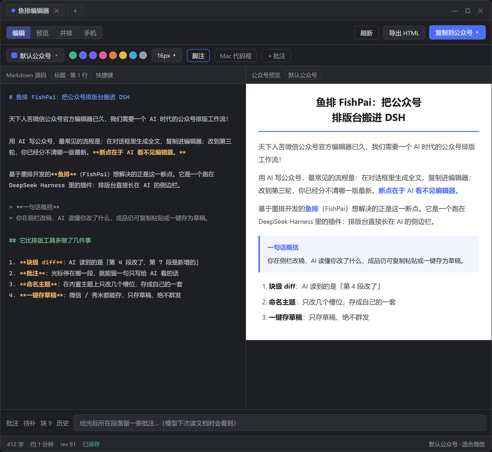
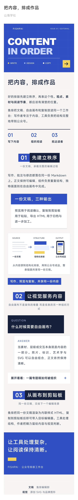

<p align="center"><a href="README.md">中文</a> • <strong>English</strong></p>

<div align="center">
<h1><br>FishPai</h1>
<p>A WeChat Official Account editor in the DeepSeek Harness sidebar.</p>
<p>Edit and annotate Markdown in the panel. The model can read a block-by-block diff and respond to your notes. Copy the formatted article into WeChat or export it as HTML.</p>
<p>
<a href="https://www.npmjs.com/package/dsh-fishpai"></a>
<a href="https://github.com/deepseek-ai/dsh"></a>
<a href="LICENSE"></a>
<a href="https://github.com/OMSociety/dsh-fishpai/stargazers"></a>
<a href="https://github.com/OMSociety/dsh-fishpai/issues"></a>
</p></div>

## What is FishPai?

FishPai is a typesetting and editing tool for WeChat Official Accounts. Write, adjust the layout, and insert interactive components on one canvas. You and the model work on the same article: your edits, comments, and requests stay attached to the relevant text.

Professional mode combines document-level canvas settings, semantic components, and custom HTML/SVG. Quick mode uses the bundled renderer and themes. See [NOTICE.md](NOTICE.md) for credits and licenses.

## Preview

<table><tr><td width="64%" align="center"></td><td width="36%" align="center"><a href="https://raw.githubusercontent.com/OMSociety/dsh-fishpai/main/docs/wechat-fishpai.png"></a></td></tr><tr><td align="center">FishPai workspace</td><td align="center">Published article on a phone</td></tr></table>

## Installation

**Install from npm**

```powershell
# Stop the running DSH instance first; restart it after installation.
dsh plugin --profile <profile> add "dsh-fishpai"
```

Use `desktop` for the desktop edition, or supply the profile you run. Refresh the DSH page and select FishPai in the right sidebar. Calling `fishpai_open` also opens the panel.

**Try it**

1. Ask the model to open a Markdown file with `fishpai_open`. The sidebar shows the article and its preview.
2. Edit the text and watch the preview. Select text and press `Ctrl/⌘+B` for bold; `Ctrl+Z` undoes the edit.
3. Paste a screenshot with `Ctrl/⌘+V`. The editor inserts ``, shows the image, and stores it beside the document in `assets/`.
4. Add a comment to a paragraph, or leave an inline request such as `<!-- 鱼排: Add a transition here -->`.
5. Ask the model to use `fishpai_read` to identify the changed block, the comment, and the line containing your request.
6. Ask it to apply the change with `fishpai_write` in `patch` mode. Only the selected block should change.
7. Use **Copy to clipboard**, then paste the headings, lists, quotes, tables and cards into the WeChat editor.
8. If WeChat's structure checker flags `line-height:0` on an SVG wrapper, choose **Continue inserting**. This SVG layout rule does not change the line height of the article text.

> **Tip**: WeChat processes HTML differently from a browser. In paste tests it converted raw `<div>` elements to unstyled `<p>` elements and stripped `href` from SVG `<image>`. Use inline styles on `<section>`, `<p>`, `<span>`, `<table>`, or `<svg>`; draw SVG shapes with `path` and `rect`. Use `:::full_bleed` for edge-to-edge content: its `max-width:none !important` offsets the width limit in WeChat's temporary preview. Start table cells with `border:0` before specifying individual borders. For lettering that needs an exact shape, use vector paths with `aria-label`. Check handwritten raw output with `fishpai_lint`. The collapsed state of `expand` and `swap` is visible; opening them depends on SMIL, so test interaction on the target account. Use paragraphs or static `:::raw` content when consistency is essential.

## Model tools

| Tool | Purpose | Main parameters |
|---|---|---|
| `fishpai_open` | Open or create a document in the panel | `path` (`.md` is optional), `markdown` (initial text), `theme`, `professional_spec` (saved canvas settings) |
| `fishpai_read` | Read block diffs, comments, inline requests, image warnings, and block IDs before editing; returns `doc_key`, `base_revision`, `read_token` | `doc_key`, `include` |
| `fishpai_write` | Edit the document from the same read; prefer a block patch | `read_token`, `base_revision` (both required), optional matching `doc_key`, `mode` (`patch` / `replace`), `patches` (`block_id` or `block_index`, `op`, `markdown`) |
| `fishpai_render` | Export clipboard-ready or archival HTML with embedded images by default | `out_path` (extension optional), `theme`, `theme_spec` (temporary quick theme), `target` (`professional` or `quick`), `professional_spec` (one-off per-key overrides), `snippetId`, `publish` (`false` for preview markup), `embed_images` |
| `fishpai_import` | Create a professional document from a public WeChat article or supplied HTML; localize assets and report structure, settings evidence, and lint results | One of `url`, `html`, `path`; `out_path` must name a new `.md` file |
| `fishpai_theme` | Save named variants of built-in quick themes as `custom:<id>` in the user's library | `action` (`set` / `show` / `clear` / `list`), `theme_id`, `theme_spec` |
| `fishpai_snippets` | Preview and confirm a reusable header or footer; apply it by name when rendering | `action`, `name`, `headerHtml`, `footerHtml`, `footerImg`, `footerAnchors`, `pending_id`, `confirm` |
| `fishpai_lint` | Check inline styling, restricted markup and CSS, text wrappers, contrast, full-width sections, and table borders | `html` |

The usual sequence is **open → edit in the panel → read → write → copy**. The bundled `fishpai` skill explains this workflow and how to choose a layout.

### Conflicts and export results

- Pass `read_token` and `base_revision` from the same read. Switching the active document does not redirect a write. If the text changed in the panel or another editor, read again and merge. Panel saves and history restores check the revision the user saw. Document settings are validated before the text is saved.
- Export creates a file. If `article.html` exists, look for `article-2.html`, `article-3.html`, and so on; the tool reports the actual path. Default export requires all images to be embedded. Resolve reported image problems and export again, or explicitly select `embed_images:false` to keep references. In reference mode, deliver the image files with the HTML. Check the embedded and referenced counts in the result.
- Import preserves literal markers at the start of paragraphs and keeps custom numbering and nested lists as raw HTML. The public page fetch has a single 15-second deadline covering DNS, redirects, and body reads. If a named header or footer changes after preview, preview and confirm it again.

## Keyboard shortcuts

| Shortcut | Action | Shortcut | Action |
|---|---|---|---|
| `Ctrl/⌘ + B` | Bold | `Ctrl/⌘ + Alt + 1/2/3` | Heading levels 1/2/3 |
| `Ctrl/⌘ + I` | Italic | `Ctrl/⌘ + Alt + 0` | Paragraph |
| `Ctrl/⌘ + E` | Inline code | `Ctrl/⌘ + Shift + .` | Quote |
| `Ctrl/⌘ + K` | Link | `Ctrl/⌘ + Shift + 8` / `+ 7` | Bulleted / numbered list |
| `Ctrl/⌘ + Shift + X` | Strikethrough | `Tab` / `Shift + Tab` | Indent / outdent |
| `Ctrl/⌘ + S` | Save | `Ctrl/⌘ + Shift + C` | Copy to clipboard |
| `Ctrl/⌘ + V` | Paste image (or drag it in) | `Ctrl/⌘ + Enter` | Submit comment from the comment box |

Open **Shortcuts** in the editor to see keys for your platform (`⌘` on Mac, `Ctrl` on Windows).

## Where data lives

| Location | Contents | Details |
|---|---|---|
| Your `.md` file | Article text | Plain Markdown, editable in any text editor. FishPai keeps its tracking metadata separately. |
| `.fishpai/docs/` | Documents created without a path | `fishpai_open` uses the article title for the file name. |
| `assets/` beside the document | Pasted or imported images | Relative links such as `assets/xxx.png` travel with the document and its assets folder. |
| `.fishpai/state/` | Revision, baseline, comments, render settings | Named by document-path hash. Deleting this state loses comments, history tracking and the model's diff baseline; the Markdown remains intact. |
| `.fishpai/history/` | Up to 50 recent snapshots | Restore a snapshot from the History drawer. The baseline used for human-edit diffs is retained separately. |
| User storage (`storageDomain`) | Named themes and snippets | Shared across workspaces and restarts; custom theme keys use `custom:<id>`. |
| `.fishpai/.gitignore` | Ignore rules for `state/` and `history/` | FishPai appends missing rules. You decide whether to track text and images. |

## Development

```powershell
npm install
npm test
npm run typecheck
npm run build
npm run build:preview
npm run check:build
npm run check:pack
node scripts/regen-golden.mjs --check
```

Tests cover rendering snapshots, site samples, document blocks, diffs, comments, patches, host checks, WeChat compatibility, themes, icons, the bundle, shortcuts, plugin mounting, client state and the API. The preview build uses the production panel and fixture and checks expanded content in Chrome. Commit the generated client bundle with client changes.

| Directory | Contents |
|---|---|
| `plugin/index.mjs` | Host entry point: tools, HTTP routes, and skill registration |
| `plugin/core/` | Rendering, Markdown, blocks, themes, snippets, WeChat lint, professional canvas, and Cheerio-based HTML import |
| `plugin/host/` | Tool contracts, HTTP routes, documents, images, themes, and storage |
| `plugin/vendor/` | Themes, markdown-it 14.1.0, highlight.js 11.9.0, and `hljs-map.json` |
| `client/`, `lib/client.js` | Browser TSX and the committed esbuild bundle installed by DSH |
| `scripts/preview/`, `docs/preview/` | Production-panel preview builder, fixture data, and self-contained panel HTML |
| `skills/fishpai/`, `test/` | Editing and layout guidance; regression and integration tests |

To check an exported file against the official WeChat structure validator, use local Chrome (not a runtime dependency):

```powershell
git clone --depth 1 https://github.com/wechatjs/verify-article-structure-spec "$env:TEMP\was"
cd "$env:TEMP\was\cli"; $env:PUPPETEER_SKIP_DOWNLOAD='true'; npm install
$env:PUPPETEER_EXECUTABLE_PATH='C:\Program Files\Google\Chrome\Application\chrome.exe'
$article = 'D:\path\article.html'                  # Supply the actual export path.
npx tsx src/index.ts $article --json                # Look for isValid: true.
```

For Bash or zsh, pass the path as a plain argument:

```bash
npx tsx src/index.ts /path/to/article.html --json
```

## Support and acknowledgments

- Star the project, open an [issue](https://github.com/OMSociety/dsh-fishpai/issues), or submit a [pull request](https://github.com/OMSociety/dsh-fishpai/pulls). Read [CONTRIBUTING.md](CONTRIBUTING.md) before contributing; report security concerns privately as described in [SECURITY.md](SECURITY.md).
- [MoPai / mopai-markdown](https://github.com/ye4wzp/mopai-markdown) (MIT): early design reference for Quick mode.
- [markdown-it](https://github.com/markdown-it/markdown-it) (MIT) and [highlight.js](https://github.com/highlightjs/highlight.js) (BSD-3-Clause): bundled vendor assets.
- [Cheerio](https://cheerio.js.org/) (MIT): parses and segments imported HTML articles.
- [DeepSeek Harness](https://github.com/deepseek-ai/dsh): hosts the plugin, sidebar, and skill.

## License and author

FishPai is maintained by [@OMSociety](https://github.com/OMSociety) under the [MIT License](LICENSE). Third-party licenses and attributions are in [NOTICE.md](NOTICE.md).
